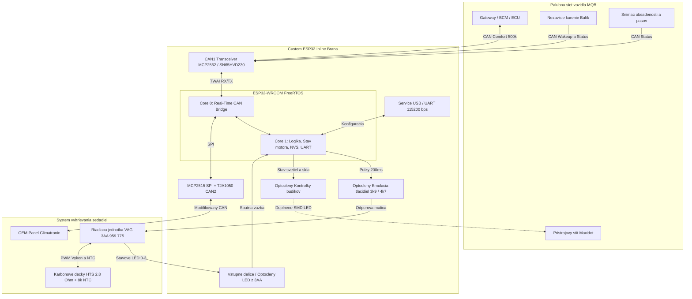

# MQB-O3-CAN-Seat-Heater-Gateway
Custom ESP32 inline CAN gateway for VAG MQB front seat heating (3AA) &amp; comfort functions.
# MQB CAN Seat Heater & Comfort Gateway (Octavia 3)

Open-Source a Open-Hardware riešenie pre integráciu predného vyhrievania sedadiel (pomocou samostatnej riadiacej jednotky 3AA) do vozidiel platformy VAG MQB (Škoda Octavia 3, Golf 7, Leon 5F) vybavených nižšou verziou jednotky BCM (Low/Medium), bez nutnosti jej výmeny a odblokovania ochrany komponentov.

Zariadenie funguje ako inteligentná **inline CAN brána (MITM)** na zbernici CAN Comfort (500 kbps) postavená na mikrokontroléri **ESP32**.

> **Poznámka k pôvodu firmvéru:** Nie som profesionálny programátor, ale elektronik a hardvérový nadšenec. Celá architektúra systému, reverzné inžinierstvo CAN zbernice, hardvérové zapojenie a funkčná logika sú mojím dielom. Zdrojový kód (C++ pre ESP32) bol vygenerovaný a odladený s pomocou umelej inteligencie (AI) presne na základe mojich technických špecifikácií a požiadaviek. Prípadné vylepšenia a optimalizácie kódu od komunity (Pull Requesty) sú vítané!

---

## Hlavné funkcie systému

### 1. Inteligentné vyhrievanie sedadiel („Pamäť bufíka“)
* **OEM ovládanie:** Plná podpora originálneho panelu Climatronic vrátane spätnej väzby a synchrónneho rozsvecovania LED indikátorov stupňov (3 -> 2 -> 1 -> 0).
* **Automatická aktivácia po nezávislom kúrení:** Ak pred jazdou bežal bufík pri vypnutom zapaľovaní, modul po naštartovaní motora automaticky zapne vyhrievanie sedadla vodiča na stupeň 3.
* **Časové okno pre spolujazdca:** Po štarte motora po behu bufíka modul otvorí konfigurovateľné časové okno (predvolené 3 minúty). Ak počas neho nasadne spolujazdec (detekcia cez snímač obsadenosti sedadla / zámok pásu), automaticky sa aktivuje aj jeho sedadlo.
* **Časovač intenzity:** Po uplynutí nastaveného času na maxime (predvolené 5 minút) modul automaticky zníži výkon zo stupňa 3 na komfortný stupeň 2. Manuálny zásah do tlačidiel túto automatiku okamžite zruší.

### 2. Energetický manažment podľa mikro-stavov motora
Modul vyhodnocuje presný stav motora z CAN dát a podľa neho chráni akumulátor:
* `MOTOR_VYPNUTY` – Výhrev je blokovaný, aby nedošlo k vybitiu batérie na mieste.
* `MOTOR_STARTUJE` – Pri aktivácii štartéra (Svorka 50) sa dečky okamžite odpájajú.
* `MOTOR_BEZI` – Plná prevádzka všetkých funkcií.
* `MOTOR_SS_STOP` – Pri dočasnom vypnutí motora systémom Štart-Stop zostáva výhrev aktívny so strážením poklesu napätia.

### 3. Doplnkové komfortné funkcie
* **Softvérová deaktivácia Štart-Stop:** Po úspešnom štarte motora modul injektuje do zbernice príkaz na deaktiváciu systému S/S.
* **Kontrola nedovretých okien:** Pri vypnutí zapaľovania a otvorení dverí vodiča modul skontroluje polohu okien a upozorní na nedovreté okná.
* **Podpora pre externé kontrolky:** Digitálne výstupy pre spínanie dodatočných LED kontroliek v prístrojovom štíte (napr. stretávacie svetlá, vyhrievanie zadného skla/zrkadiel).

### 4. Konfigurácia a spánok
* **UART konzola:** Nastavenie časových konštánt cez sériovú linku s trvalým uložením do NVS pamäte ESP32 (bez použitia Wi-Fi/BT).
* **Deep Sleep:** Pri uspatí palubnej siete vozidla prejde modul do hlbokého spánku s minimálnym odberom. Okamžité prebudenie nastáva pri akejkoľvek aktivite na zbernici (odomknutie, diaľkový štart bufíka).

---

## Hardvérový základ (BOM) a závislosti
* **MCU:** ESP32-WROOM (využitie oboch jadier cez FreeRTOS – Core 0 pre CAN bránu, Core 1 pre logiku).
* **CAN1 (Smer vozidlo):** Interný TWAI radič + transceiver (napr. MCP2562-E/P alebo SN65HVD230).
* **CAN2 (Smer Climatronic):** Externý radič MCP2515 (SPI, 16 MHz) + transceiver TJA1050.
* **Riadiaca jednotka výhrevu:** VAG 3AA 959 775 (A) + odporová emulácia tlačidiel cez optočleny (3k9 / 4k7).
* **Vyhrievacie telesá:** Karbónové dečky s NTC termistorom (8 kΩ pri 25 °C).
* **Softvérové knižnice (Dependencies):** `autowp-mcp2515` (MIT), Espressif `driver/twai.h` (Apache 2.0), `Preferences.h`.

---

## Licencia (Open-Source & Open-Hardware)
Tento projekt vznikol v duchu slobodného zdieľania vedomostí. Komerčné využitie a výroba modulov pre komunitu je vítaná za predpokladu dodržania podmienok otvorenosti:
* **Zdrojový kód (Firmware):** Licencované pod **GNU General Public License v3.0 (GPL-3.0)**.
* **Hardvér a schémy:** Licencované pod **CERN Open Hardware Licence v2 – Strongly Reciprocal (CERN-OHL-S)**.

## Vylúčenie zodpovednosti (Disclaimer)
Tento projekt slúži na vzdelávacie a hobby účely. Zásahy do elektroniky a dátovej zbernice vozidla vykonávate na vlastné riziko. Autor nenesie žiadnu zodpovednosť za prípadné škody na vozidle, elektronike alebo zdraví.

# Technická architektúra systému

## 1. Bloková schéma zapojenia

Systém je zapojený ako **inline brána (Man-In-The-Middle)** priamo na vetve zbernice **CAN Comfort (500 kbps)** vedúcej k panelu Climatronic. Všetky ostatné uzly vozidla (Gateway, BCM, Webasto, prístrojový štít) zostávajú na primárnej strane zbernice.

---

## 2. Hardvérová architektúra

### Oddelenie zberníc (Dual-CAN)
Aby bolo možné selektívne modifikovať správy pre Climatronic bez ovplyvnenia zvyšku auta, komunikácia je fyzicky rozdelená na dve nezávislé zbernice s rýchlosťou **500 kbps**:
* **CAN1 (Strana vozidla):** Využíva interný hardvérový radič **TWAI** priamo v čipe ESP32. Pre prispôsobenie napäťových úrovní slúži transceiver s 3.3V logikou (napr. `MCP2562-E/P` s pinom Vio na 3.3V alebo `SN65HVD230`).
* **CAN2 (Strana Climatronicu):** Riešená externým radičom **MCP2515** (s 16 MHz kryštálom) pripojeným cez hardvérovú zbernicu **VSPI** a transceiverom `TJA1050`.

### Rozhranie pre jednotku 3AA 959 775
Riadiaca jednotka 3AA (pôvodne pre zadné sedadlá) je autonómna a nekomunikuje po CAN zbernici. Ovláda sa analógovo/diskrétne:
* **Emulácia tlačidiel:** Jednotka 3AA sníma požiadavky na zmenu stupňa cez jeden spoločný vstupný pin na základe prizemnenia cez špecifický odpor (**3,9 kΩ** pre jedno sedadlo, **4,7 kΩ** pre druhé sedadlo). ESP32 spína tieto odpory proti kostre pomocou **optočlenov (PC817)** vyslaním 200 ms pulzu (koncernová logika cyklovania: `0 -> 3 -> 2 -> 1 -> 0`).
* **Spätná väzba (Feedback):** Výstupy z jednotky 3AA určené pre napájanie indikačných LED diód v tlačidlách sú privedené (cez odporové deliče / optočleny) na digitálne vstupy ESP32. Modul tak v reálnom čase pozná skutočný stupeň vyhrievania a deteguje prípadný zásah užívateľa alebo chybový stav.
* **Tepelná regulácia:** Jednotka 3AA riadi výkon do karbónových dečiek (2,8 Ω paralelne, cca 70 W na sedadlo) pomocou nízkofrekvenčnej **PWM modulácie** na základe spätnej väzby z integrovaného **8 kΩ NTC termistora** (zhodná krivka s originálnymi VAG dečkami).

---

## 3. Softvérová architektúra (FreeRTOS Dual-Core)

Pre zaistenie nulového oneskorenia (latencie) pri preposielaní správ medzi vozidlom a panelom Climatronic je firmvér striktne rozdelený medzi obe výpočtové jadrá ESP32:

### Core 0 – Real-Time CAN Gateway (MITM)
* Beží s najvyššou prioritou bez akýchkoľvek blokovacích funkcií (`delay()`).
* Okamžite preposiela všetky pakety z `CAN1 -> CAN2` a z `CAN2 -> CAN1`.
* **MITM manipulácia:** Pri zachytení stavovej správy od BCM (obsahujúcej potvrdenie o behu výhrevu pre Climatronic) prepíše príslušné bity podľa aktuálneho stavu vyčítaného z jednotky 3AA. Panel Climatronic tak korektne rozsvieti 1 až 3 oranžové LED diódy.
* **Priepustnosť pre nezávislé kúrenie:** Správy od bufíka (pri vypnutom zapaľovaní) prechádzajú transparentne na CAN2, čo zabezpečí prebudenie Climatronicu a spustenie ventilátora interiéru.

### Core 1 – Stavový automat (State Machine) a doplnky
* **Sledovanie mikro-stavov motora:** Vyhodnocuje otáčky (RPM), stav Svorky 15 (zapaľovanie), Svorky 50 (štartér) a príznaky systému Štart-Stop. Rozlišuje stavy `MOTOR_VYPNUTY`, `MOTOR_STARTUJE` (okamžité odpojenie záťaže), `MOTOR_BEZI` a `MOTOR_SS_STOP` (udržanie výhrevu na križovatke s ochranou proti poklesu napätia).
* **Logika „Pamäť bufíka“:** Ak modul zaznamená beh nezávislého kúrenia pri vypnutom motore, uloží príznak do pamäte. Po následnom naštartovaní motora automaticky aktivuje výhrev vodiča (stupeň 3) a otvorí konfigurovateľné časové okno (predvolene 180 s) pre detekciu nasadnutia spolujazdca (cez CAN správu snímača obsadenosti/pásu).
* **Časovač intenzity:** Odpočítava čas behu na maxime (predvolene 300 s) pomocou neblokujúcej funkcie `millis()` a následne jedným pulzom zníži výkon na stupeň 2.
* **Konfigurácia NVS:** Cez sériovú linku (`Serial`) prijíma textové príkazy na zmenu časových konštánt a ukladá ich do trvalej flash pamäte (`Preferences.h`).

---

## 4. Energetický manažment a Deep Sleep

* **Detekcia nečinnosti:** Ak na oboch CAN zberniciach ustane komunikácia na viac ako 60 sekúnd (vozidlo je zamknuté a uspané), ESP32 nakonfiguruje externé hardvérové prerušenie (`ext0`) na **RX pine CAN1 transceivera** a prejde do režimu `esp_deep_sleep_start()` (odber v rádoch mikroampérov).
* **Okamžité prebudenie:** Akákoľvek aktivita na zbernici (odomknutie vozidla, otvorenie dverí alebo diaľkový štart bufíka) vyvolá dominantnú hranu na linke CAN, čo prebudí ESP32 v priebehu zlomku milisekundy.
